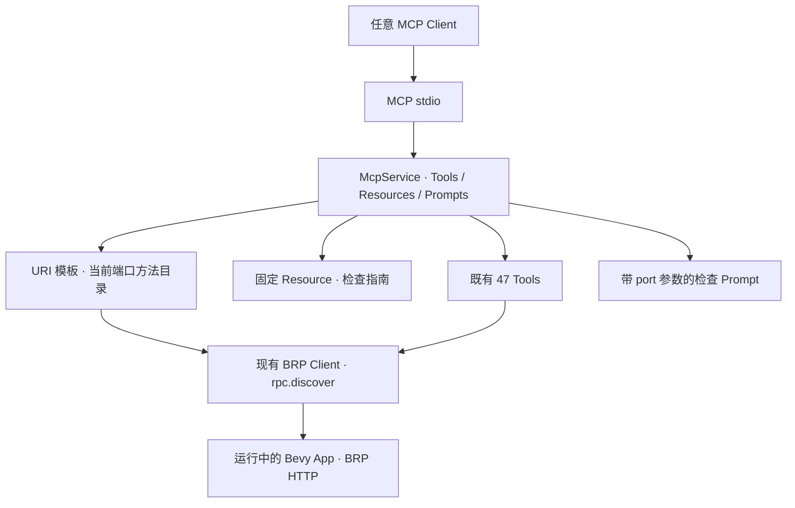

# 为 MCP Server 提供可读取的 Bevy 资源与可参数化的检查提示词

当前 `crates/mcp/` 作为 stdio MCP Server 提供了 47 项常规原生 Tools。其 `McpService::get_info` 只声明 Tools，处理器只实现工具列表和调用。这份方案在**不改变现有 47 个工具行为**的前提下，给同一个 MCP Server 增加 MCP Resources 与 MCP Prompts，让客户端既能测试真实 Bevy BRP 工具，也能验证标准 `resources/list`、`resources/templates/list`、`resources/read`、`prompts/list` 和 `prompts/get` 的完整协议行为。

Resources 与 Prompts 在同一个产品场景中协作：Resource 解释如何检查 Bevy App、可按实际 BRP 端口读取当前可用方法；Prompt 把端口参数展开成一次检查任务，提示客户端读取资源并调用已有 BRP 工具。它们是服务器的公共 MCP 能力，不是对现有 App 端 BRP method 或原生 Tools 的替换。

MCP Server 与 Bevy App 之间仍只有 BRP 协议连接。`crates/extras`、`crates/runtime` 与 App 的 ECS 系统无须为了这两个 MCP 能力新增入口。与 MCP Tool 的 `structuredContent` 不同，Resource 读取返回 MCP Resource Contents，Prompt 展开返回 MCP Prompt Message；不能为了复用旧工具响应宏而强行把新响应压成工具 JSON 文本。

## 资源：从说明材料到可查询的运行信息

### 固定的 BRP 检查指南

提供一项始终可用的文本资源，例如 `bevy-brp://guide/inspection`。通过 `resources/list` 公布稳定 URI、名称、简要说明与 `text/markdown` MIME；`resources/read` 返回其真实 Markdown 文本。内容从当前公共工具能力出发说明：BRP 目标 App 与 stdio MCP Server 是两个程序，默认 BRP 端口为 15702；可以使用已有 `rpc_discover`、`brp_execute`、`world_get_components` 和截图等工具对真实状态做核对；成功的工具请求不自动等于最终 UI 行为验证成功。

指南由服务器二进制自带的只读材料提供，不依赖 Bevy App 正在运行，不引用开发者机器的绝对路径，也不泄露本地日志、环境变量或认证状态。固定 URI 不因服务器多次启动而变化，返回 MIME 与文本内容保持一致。

### 根据 BRP 端口读取当前方法目录

提供一个 URI 模板，例如 `bevy-brp://app/{port}/methods`，用 `resources/templates/list` 公布。用户给出明确的 BRP 端口后，`resources/read` 才通过现有 BRP Client 向对应 App 发出 **`rpc.discover` 只读请求**，把实际发现的方法目录按 `application/json` 内容返回。保留响应中的方法名与相关结构，必要时附上原始端口作为来源字段，但不要把一次方法发现包装成应用已成功操作的假结果。

`port` 必须是有效的端口字段，不能隐式启动 App、构建项目、修改组件或创建 watch。目标端口没有可响应 BRP 的应用、方法不存在、调用超时或返回畸形 JSON 时，返回有界且可诊断的读取错误；不能偷偷回退到默认端口并声称读取成功。若 MCP SDK 采用 URI 模板中的完整路径匹配规则，实施时应按它的真实解析能力保留相同的用户可观察 URI 契约，而不为路径解析另造全局 Router。

`resources/list` 只列举真实固定资源，不把每一个可能端口的模板伪装成已存在的具体资源。服务端可对资源列表应用协议所需的分页/缓存结果约定；新协议若要求 `ttlMs`、`cacheScope` 等元数据，应与实际是否可缓存一致。实时方法目录不应被错误标为永久可复用的静态内容。

## 提示词：把参数转换成明确的检查任务

提供一个 MCP Prompt，例如 `inspect_bevy_app`。`prompts/list` 公开其名称、用途及必填的 `port` 参数（字符串形式，给出可读的端口含义）；`prompts/get` 校验参数并返回**单条 user 角色、纯文本的 MCP Prompt Message**。模板内容明确指出：检查用户指定端口的 Bevy App，先读取 `bevy-brp://guide/inspection` 与 `bevy-brp://app/{port}/methods`（客户端支持资源时），根据真实目录使用已有工具查询状态，并向用户描述实际观察结果，而非预设一切正常。

这个 Prompt 本身**不执行 BRP 调用**，也不在返回时创建 Bevy App 或修改 ECS。它只是一次可重用的、带参数的任务文本；客户端是否使用以及是否真正调用工具由客户端和用户决定。文本需要让端口替换在预览中可直接核对，例如以 `15712` 获取时结果中的资源 URI 与工具指引均指向该端口，而不仍写 15702。

参数缺失、不是合法端口、未知 Prompt 名、无法接受的额外参数，都要返回 MCP 约定的错误，并让调用方能区分校验失败与传输失败。Prompt 里的 Resource URI 是公开提示性信息，不向模型或客户端暗示读取它具有额外授权。

## 在现有 MCP Server 中增加这两个能力

在现有 `crates/mcp/src/mcp_service.rs` 中扩展 `ServerHandler`，向 `get_info()` 增加 Resources 与 Prompts capability，同时保留原有 Tools。按照 rmcp 当前 `ServerHandler` 的方法签名实现 `list_resources`、`list_resource_templates`、`read_resource`、`list_prompts`、`get_prompt`，并使用其定义的 `Resource`、`ResourceTemplate`、`ReadResourceResult`、`Prompt`、`GetPromptResult` 等类型。具体字段/错误签名以项目固定的 rmcp 依赖为准，不用自定义 JSON-RPC 结构替代 SDK 公开模型。

现有 MCP 的请求、资源和提示词业务可以分成内聚的内部 module，但不为两个简单能力增加新的 workspace Crate 或外部公共 Rust API。`crates/mcp/src/main.rs` 仍只装配 stdio 服务。固定 Resource 使用服务器侧明确拥有的只读文本；端口方法 Resource 重用已有 `brp_tools` 的 HTTP/BRP Client 及错误处理契约，不通过启动子进程再次调用 `bevy_brp_mcp` 自己。方法发现的 port、status、原始 BRP 错误与可见诊断应保留，不与 `ToolResult` 的 `isError` 混淆。

服务器主线使用当前 rmcp 协议协商能力。现有文档说明新旧 MCP 协议分别使用旧版 initialize/initialized 和新版本请求级 `_meta`；Resources/Prompts 的新增声明及响应应遵守连接实际采用的协议版本，包括需要的列表元数据、错误关联和返回内容类型，而不是只在单一旧版工具客户端上能工作。

## 既有工具与 BRP 公共接口保持不变

原有 `tools/list` 的 47 项普通工具（显式诊断 feature 下额外的 trace 工具）必须继续保持名称、input/output Schema、annotation、错误与 `structuredContent` contract。新增 Resources 与 Prompts 不能出现在 `tools/list`，也不把 `AppAgentToolExt::register_agent_tool` 的动态 method 元数据自动翻译成 MCP Tools。`rpc_discover`、`brp_execute` 等依然按现有行为供模型调用；新的资源读取只使用只读 BRP 方法。

改变 MCP Server 对外可观察能力时，同步 `docs/mcp.md` 的使用方式、真实 URI/参数与结果样例，以及必要的 MCP help text/rustdoc；如果未改变 crate 角色、依赖边界和公共入口，不机械修改 `docs/architecture.md`。不修改 `crates/extras`、`crates/runtime`、BRP HTTP listener、Bevy 指针输入、截图管线或任何外部消费者仓库。Git tag、版本和发布流程不属于当前目标。

## 从协议结果到实际客户端的验证

这是服务端仓库，依照现有工程规范采用 Type-Driven Development 与 Red → Green → Refactor。先用对应的测试表达公开能力和错误 contract，再完成最小实现，随后执行真实 MCP stdio 验证。测试不是另立的项目目标，而是这项公共功能自身的完成条件。

**资源行为的验证**应覆盖：

- `server capabilities` 同时声明 Tools、Resources、Prompts，既有 `tools/list` 名称数量及执行 contract 不变；固定资源列表和读取结果的 URI、MIME、文本一致。
- 模板列表存在明确的 `{port}`，按有效实际端口读取 `rpc.discover` 的方法目录；错误端口、无服务端口、畸形/过大 BRP 响应和超时返回可区分的错误。静态指南无需 Bevy App 仍可读，实时模板不把请求失败转换为成功的空清单。
- 资源列表若分页，下一页和终止指示正确；在旧版和新版 MCP 协议下返回值满足实际协商要求，不因为缺少缓存元数据导致新客户端丢失所有资源。

**提示词行为的验证**应覆盖：

- `prompts/list` 报告 `inspect_bevy_app` 的名称、含义和必填端口；`prompts/get` 用两组不同合法端口取得不同、准确替换的 user 文本，内容不含伪造工具执行结果。
- 缺少或畸形端口、未知名称、额外无效字段返回结构化 MCP 错误；只要服务器在线，即使没有 Bevy App，Prompt 仍可成功展开，因为它不代替工具执行。
- 与独立 MCP Client 的端到端交互：发现 Resource、预览并读取真实文本，获取 Prompt 并提交用户输入，再由该客户端决定实际调用既有 BRP Tools。确认模型使用的是本次读取和展开的内容，而不是服务器侧提前执行或伪造的历史。

**工程与运行验证**：根据变更运行 `cargo fmt --all -- --check`、定向 `cargo test -p bevy_brp_mcp --locked`、受影响 package 的 `cargo check` 和 Clippy；如果调整了跨包契约，再按规则扩大到 workspace。使用现有 `test-app` 或已有真实 Bevy 目标以独立测试端口跑通 **MCP stdio → Resources 读取 → BRP `rpc.discover`**，在结束后关闭测试 App、检查端口与进程回收。对 stdio 协议的自动测试与真实运行都属于此目标，不用无关的全仓重构替代。代码行为改动完成后按照该仓库规则开展独立 Code Review，修复发现项并重复必要验证。

## 需要守住的边界

- MCP Server 的 stdio、BRP HTTP、Bevy App 三个运行边界保持分开；资源读取不改变 App 状态，模板获取不隐式请求模型、不向 App 发送控制操作。
- 使用有界文本、内容数量与协议超时处理错误；日志不记录不必要的完整资源正文或用户模板参数，不将 BRP 内部错误隐藏成 MCP 成功。
- 本方案只扩展 Resources 和 Prompts，不提供 MCP Resources 订阅、Sampling、Elicitation、Roots、Tasks、MCP HTTP 服务端传输或插件系统。
