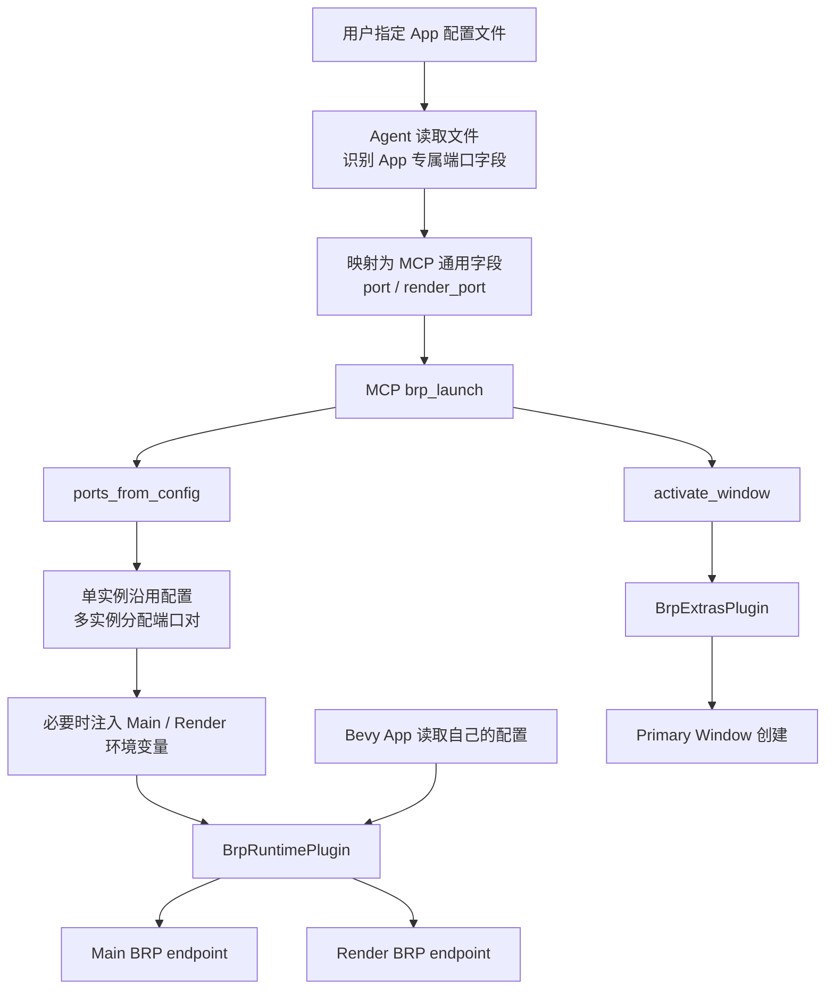

# 窗口启动行为与 BRP 双端口管理

这组改动处理两个相互独立的问题：MCP 启动 Bevy 程序时不应意外抢占用户正在使用的窗口焦点；BRP Runtime 的 Main 与 Render HTTP endpoint 则必须拥有明确、可配置且不会在多实例之间冲突的端口。

窗口焦点由 `brp_launch` 参数转换成进程环境配置，再由 Bevy App 在原生窗口创建前应用。端口则分成 App 配置和 MCP 启动管理两层：App 使用自己的配置文件和字段命名决定 Main / Render 端口；Agent 在实际调用 MCP 前读取用户指定的配置文件，识别对应端口值，并映射到 MCP 的通用参数 `port`、`render_port`。MCP 不解析 App 配置文件，也不需要知道 App 专属字段名称。

单实例沿用 App 配置时，Agent 将读取到的端口值传给 MCP，并标记 `ports_from_config=true`；MCP 使用这些值作为连接目标，但不注入端口覆盖环境变量。显式要求覆盖或需要启动多个实例时，MCP 才分配端口对并通过环境变量覆盖 App 配置。

## 实施顺序

1. [让 MCP 启动的窗口默认不抢焦点](01-window-focus.md)
2. [为 Runtime 与 Extras 提供正式的双端口配置](02-runtime-dual-port-config.md)
3. [让 MCP 按通用端口参数与实例分配 Main / Render 端口对](03-mcp-port-allocation.md)

第 1 项与端口改动没有技术依赖，先行只是统一执行顺序。第 2 项建立 App 侧双端口配置能力，第 3 项依赖该能力，并通过 Agent 将 App 配置映射为 MCP 通用端口参数。
