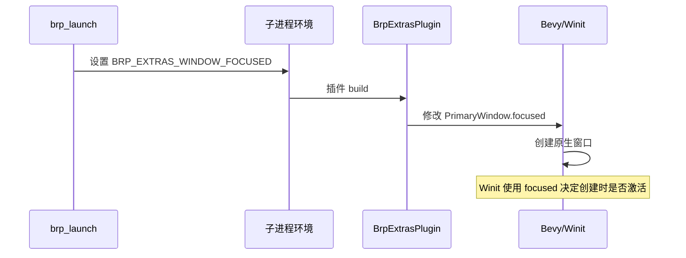

# 让 MCP 启动的窗口默认不抢焦点

## 目标与范围

MCP 使用 `brp_launch` 启动 Bevy 程序时，默认不应将新窗口激活到前台，也不应抢走用户正在使用的其他程序的输入焦点。调用者可以通过 `activate_window=true` 显式要求激活新窗口。

此行为只针对 MCP 启动的进程。用户手动启动程序时，不设置 MCP 专用环境变量，继续使用 Bevy 的默认窗口行为。本次实现只考虑 Windows，不增加跨平台兼容层。

本增量包括 `brp_launch` 参数、进程环境变量传递、Extras 对 PrimaryWindow 的启动前处理，以及对应的测试和文档。

## 为什么要在窗口创建前处理

Bevy 0.20 的 `Window::default()` 将 `focused` 设为 `true`。Bevy Winit 在创建原生窗口时把该属性传给 Winit 的 `with_active(window.focused)`。因此，仅在窗口已经创建后把 `Window.focused` 改成 `false` 并不能可靠地撤销创建时的激活请求；Bevy 文档也说明窗口创建后不能通过该属性设置为未聚焦状态。

MCP 当前的进程启动函数只负责创建子进程、重定向日志和进程回收，没有主动调用 Windows 的窗口置前 API。应在 Bevy 创建原生窗口之前改变 Bevy 的窗口配置，而不是在 MCP 进程管理层操作 HWND 或调用 `SetForegroundWindow`。



## 启动参数与环境变量

`brp_launch` 增加布尔参数 `activate_window`，默认值为 `false`。

- `false`：MCP 为子进程设置 `BRP_EXTRAS_WINDOW_FOCUSED=false`。
- `true`：MCP 为子进程设置 `BRP_EXTRAS_WINDOW_FOCUSED=true`。

环境变量由 MCP 在启动命令中设置，Extras 在应用构建阶段读取。环境变量未设置时，Extras 不修改 PrimaryWindow 的 `focused` 属性，因而手动启动程序保持 Bevy 默认行为。

```text
MCP 参数                         子进程环境变量
activate_window = false   ->   BRP_EXTRAS_WINDOW_FOCUSED=false
activate_window = true    ->   BRP_EXTRAS_WINDOW_FOCUSED=true
参数省略（默认 false）     ->   BRP_EXTRAS_WINDOW_FOCUSED=false
手动启动程序               ->   不设置该变量
```

## 在 Extras 中应用焦点策略

`BrpExtrasPlugin` 在插件构建期间检查 `BRP_EXTRAS_WINDOW_FOCUSED`。当变量是合法布尔值且存在 PrimaryWindow 时，修改该窗口的 `Window.focused`，使配置在 Winit 创建原生窗口之前生效。

`BrpRuntimePlugin` 已组合安装 `BrpExtrasPlugin::without_http_transport()`，因此 Runtime 用户也获得相同的窗口行为，不需要在 Runtime 中重复实现焦点控制。

实现需要遵守插件时序：`DefaultPlugins` 已经安装 `WindowPlugin` 并创建 PrimaryWindow ECS entity，但 Winit 原生窗口创建由事件循环后续处理。Extras 必须在该原生窗口创建前修改 ECS 中的 `Window`。如果没有 PrimaryWindow（例如无窗口 App），不执行窗口修改。

变量未设置时不主动把 `focused` 改为 `true`，也不重写宿主对窗口的自定义设置。对非法变量值的处理应保持无副作用并记录诊断，不应让 App 因为可选的焦点配置而 panic。

## 验收

- `brp_launch` 省略 `activate_window` 时，启动窗口不激活，原本正在使用的其他程序继续保持前台焦点。
- `activate_window=false` 与省略参数行为一致。
- `activate_window=true` 时，Bevy 窗口按原有默认行为请求激活。
- 手动运行同一个 Bevy 程序且未设置 `BRP_EXTRAS_WINDOW_FOCUSED` 时，窗口行为不变。
- Runtime 组合路径和 Extras 独立插件路径均使用同一焦点处理逻辑。
- 无 PrimaryWindow 的 App 正常启动。
- 对非法环境变量值不 panic，且不会意外修改窗口焦点。

## 防御性边界

- 不在 MCP 进程管理代码中调用 Win32 窗口置前 API。
- 不改变 Bevy 的全局默认值，不要求所有手动启动的 App 默认后台运行。
- 不改动输入注入、鼠标位置、窗口可见性或窗口层级行为；本增量只控制窗口创建时的激活请求。
- 不增加 macOS、Linux 或其他平台专用行为。
