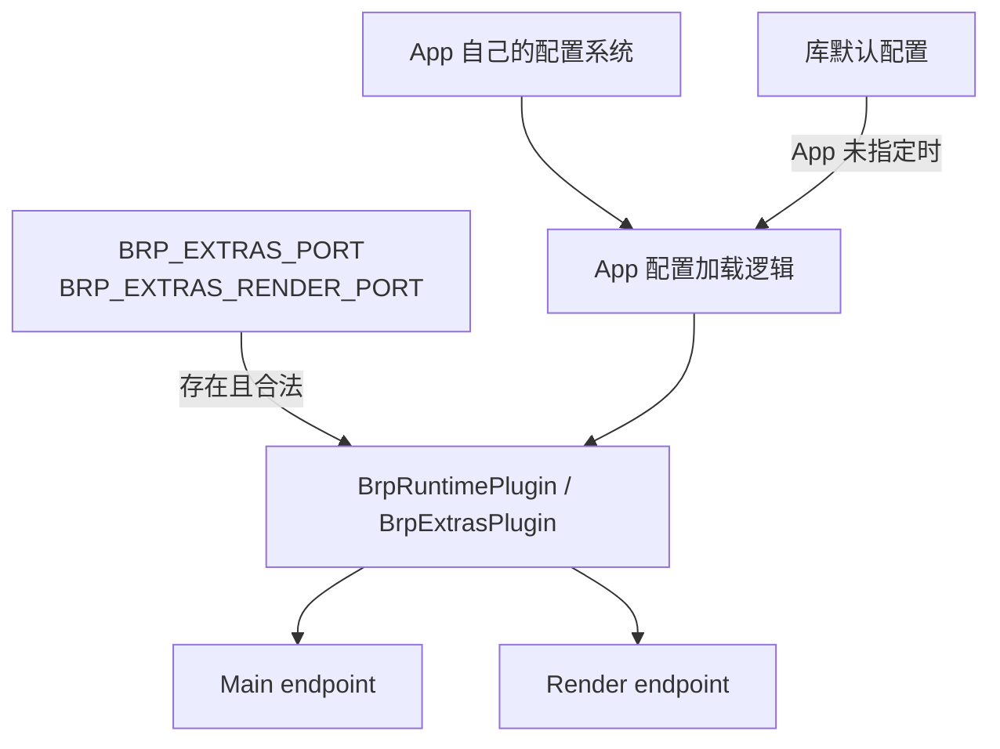

# 为 Runtime 与 Extras 提供正式的双端口配置

## 目标与范围

BRP Runtime 当前为 Main World 与 Render World 分别启动 HTTP endpoint，但只有 Main 端口有本地配置入口，Render endpoint 仍使用 Bevy 的固定默认端口。多个独立 Bevy 进程因此会争抢同一个 Render 端口。

本增量为 App 侧提供一致的 Main / Render 双端口配置能力，并让 Runtime 与独立使用的 Extras 都遵守相同的配置优先级。App 继续使用自己的配置文件和字段命名；MCP 不解析该文件，也不需要知道 App 专属字段。实际使用时由 Agent 读取用户指定的配置文件，识别 Main / Render 端口并映射到 MCP 通用参数。

## 配置责任与优先级

程序负责选择和应用自己的正式端口。App 可以通过自己的配置文件、配置加载代码或其他现有配置系统取得 Main / Render 端口，再传给 Runtime 或 Extras 的配置 API。不同 App 可以使用不同配置格式和字段名称。

进程环境变量是进程级覆盖机制，供 MCP 在显式覆盖或多实例管理时使用。配置优先级统一为：

1. 进程环境变量：最高优先级，用于 MCP 显式覆盖或多实例隔离。
2. App 自己的配置：由 App 自己读取和解释，字段名称及文件格式由 App 决定。
3. 库默认值：Main 为 `15702`，Render 为 `15703`。



Main 与 Render 必须分别解析，不能因为 Main 端口被覆盖，就继续把 Render 端口固定为 `15703`。两个环境变量分别控制对应 endpoint；单独缺省或非法时，只影响对应 endpoint 的回退。

## Runtime 公共 API

`BrpRuntimePlugin` 增加双端口配置入口：

```rust
BrpRuntimePlugin::with_ports(main_port, render_port)
```

例如：

```rust
App::new()
    .add_plugins(DefaultPlugins)
    .add_plugins(BrpRuntimePlugin::with_ports(9000, 9001))
    .run();
```

Main 使用 `9000`，Render 使用 `9001`。`Default` 仍使用 `15702/15703`。

现有 `with_port(port)` 是已经存在的公共入口，应保留以避免破坏现有消费者。它继续配置 Main；Render 沿用 Bevy 默认值 `15703`，除非该兼容行为在实现时被明确替换为成对推导并同步更新文档。双端口配置的新入口不应依赖调用者先后调用两个 builder 才能得到完整配置。

App 的配置加载逻辑从 App 自己的配置文件或配置系统中取得两个值，再调用 `with_ports(...)`。Runtime 不需要知道 App 使用 TOML、JSON、RON、环境变量还是其他方式组织配置。

## 环境变量覆盖

保留现有 `BRP_EXTRAS_PORT` 作为 Main 端口覆盖变量，新增 `BRP_EXTRAS_RENDER_PORT` 作为 Render 端口覆盖变量。

Runtime 启动时分别解析两个变量。合法的环境变量优先于 App 传入的代码配置；变量缺省时使用 App 配置；App 也未配置时使用 `15702/15703`。

非法端口值应回退到对应的 App 配置值，并给出清楚的 warning，不能让 Main 的非法值影响 Render，也不能静默把 Render 端口回退到固定的 `15703` 而忽略 App 配置。

## Extras 独立使用路径

`BrpExtrasPlugin` 不仅用于 Runtime。它也可以独立安装，并由 Bevy 原生 `RemoteHttpPlugin` 提供 HTTP transport。因此双端口配置不能只实现于 `bevy_brp_runtime`。

Extras 的默认和显式端口配置需要支持 Main 与 Render 两个 endpoint。独立 Extras 路径继续使用 Bevy 原生 `RemoteHttpPlugin`，但需要在 Render HTTP server 启动前，将 Render World 的 `HostPort` resource 设置为解析后的端口。Main 使用现有 `RemoteHttpPlugin::with_port` 配置。环境变量优先级与 Runtime 一致。

`BrpExtrasPlugin::without_http_transport()` 不拥有 HTTP transport，不应自行启动或改写宿主提供的 endpoint；Runtime 继续通过自己的 transport 负责双端口。对于 `with_http_plugin(plugin)` 这种由调用者提供完整 `RemoteHttpPlugin` 的路径，用户提供的 transport 仍然是权威配置，Extras 不应悄悄覆盖它的端口。

## Agent 与 MCP 的配置文件边界

App 配置文件的格式、字段名称、嵌套结构及字段语义完全由 App 决定。MCP 不增加 `config_file` 参数，不读取或解析 App 配置文件，也不定义 App 配置文件 schema。

当用户指定某个配置文件并要求启动 App 时，Agent 负责读取该文件，结合项目代码或文档判断哪个值对应 Main BRP 端口、哪个值对应 Render BRP 端口，然后将数值映射到 MCP 的通用参数 `port` 与 `render_port`。如果无法可靠判断字段含义，Agent 应先澄清，不得猜测。

## 验收

- Runtime 默认启动 Main `15702`、Render `15703`。
- `BrpRuntimePlugin::with_ports(9000, 9001)` 分别监听指定端口。
- `BRP_EXTRAS_PORT` 和 `BRP_EXTRAS_RENDER_PORT` 分别覆盖代码配置。
- 单个变量缺省或非法时，只影响对应 endpoint 的回退。
- Runtime 的 Main / Render `rpc.discover` 均可用。
- Runtime 任一 endpoint bind 失败时，现有共享失败与关闭语义仍然成立。
- Extras 独立安装时，Main / Render 均使用相同的双端口配置规则。
- `with_http_plugin` 保持调用者提供的 transport 配置，不被隐式覆盖。
- `without_http_transport` 不创建额外 listener。
- 现有 `with_port` API 保持兼容，既有单端口消费者行为有回归测试覆盖。
- App 使用不同配置格式或不同字段名称时，Runtime / Extras 均不需要修改；Agent 可以将其映射为 MCP 通用参数。

## 防御性边界

- 不改变 BRP JSON-RPC、HTTP 或 SSE 协议。
- 不改变 Main 与 Render mailbox 的职责和生命周期模型。
- 不将 MCP 的默认端口分配策略写入 Runtime 的默认配置。
- 不让 Extras 在调用者已经提供 `RemoteHttpPlugin` 时暗中接管其端口配置。
- 不让 MCP 依赖某一种 App 配置格式或 App 专属字段名称。
