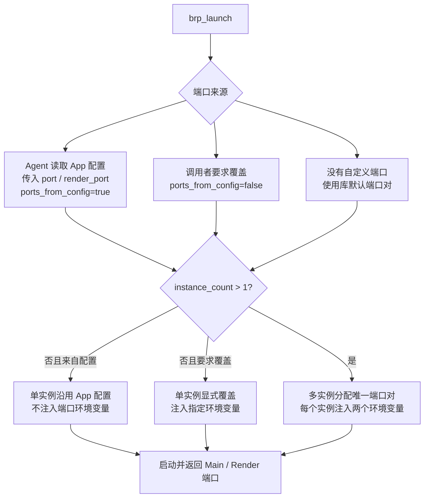

# 让 MCP 按通用端口参数与实例分配 Main / Render 端口对

## 目标与范围

MCP 的 `brp_launch` 当前只为每个实例分配一个 Main 端口，并通过 `BRP_EXTRAS_PORT` 传递给子进程。Runtime 同时启动 Render endpoint，而 Render 端口固定为 `15703`。因此多个 MCP 启动的程序会争抢 Render 端口；当第二个进程绑定失败时，Runtime 的共享 lifecycle 会关闭该进程的 Main 与 Render endpoint。

本增量让 MCP 将 Main 与 Render 作为一对管理。MCP 只定义自己的通用字段名称，不解析 App 配置文件，也不关心具体 App 使用什么字段、文件格式或嵌套结构。实际调用时，Agent 根据用户指定的配置文件自行查找 App 的 Main / Render 端口字段，再映射到 MCP 的 `port`、`render_port` 参数。

单实例沿用 App 已配置端口时，Agent 设置 `ports_from_config=true`；MCP 使用传入的端口值作为连接目标，但不注入端口覆盖环境变量。显式覆盖或多实例隔离时，MCP 才注入环境变量。

## 为什么必须分配端口对

Runtime 每个进程都会创建两个 listener：Main World 与 Render World。两个 endpoint 虽然属于同一个 App，但各自绑定独立 TCP 端口。只递增 Main 端口不能解决多实例冲突。

例如只递增 Main 时：

```text
实例 A：Main 15702，Render 15703
实例 B：Main 15703，Render 15703
```

实例 B 的 Main 还会与实例 A 的 Render 冲突，而两个 Render endpoint 也会争抢 `15703`。因此分配器必须把 Main 与 Render 视为不可拆开的端口对。

## MCP 通用参数

`brp_launch` 保留现有 `port` 参数表示 Main 端口，并增加：

- `render_port`：Render 端口。
- `ports_from_config`：布尔值，表示传入的 `port` 和 `render_port` 是 Agent 从 App 配置中识别出的现有端口，而不是要求 MCP 覆盖 App 配置。默认 `false`，以保持显式端口参数原有的覆盖语义。

MCP 不增加 `config_file` 参数。配置文件路径是 Agent 在调用工具前使用的上下文：用户可以在自然语言请求中指定文件，Agent 自行读取并识别 App 专属字段。Agent 只把解析出的数值传给 MCP，不把 App 专属字段名称传给 MCP。

例如，App 配置文件可能使用：

```toml
[network]
game_server = 9000
render_debug = 9001
```

Agent 判断 `game_server` 对应 Main、`render_debug` 对应 Render 后，调用 MCP 时使用自己的通用字段：

```json
{
  "target_name": "my_bevy_app",
  "port": 9000,
  "render_port": 9001,
  "ports_from_config": true
}
```

另一个 App 即使使用不同文件格式和完全不同的字段名，也采用相同的 MCP 参数。Agent 如果无法可靠判断字段对应关系，应先询问用户，不得猜测。

## 单实例：沿用 App 配置，不注入覆盖值

单实例且 Agent 已从 App 配置文件识别端口时：

1. Agent 读取用户指定的配置文件，结合项目代码或文档确定 Main 与 Render 端口。
2. Agent 将数值映射到 `port`、`render_port`，并设置 `ports_from_config=true`。
3. MCP 将两个值作为 BRP 连接目标和启动结果中的端口信息。
4. MCP 不设置 `BRP_EXTRAS_PORT` 或 `BRP_EXTRAS_RENDER_PORT`，App 使用自己的配置加载逻辑和 Runtime / Extras API 启动对应 endpoint。

`ports_from_config=true` 时，`port` 和 `render_port` 都必须提供。MCP 不从 App 文件读取字段，也不验证这些数值是否真的对应 App 内部配置；字段识别和语义确认属于 Agent 的职责。MCP 仍验证端口值本身是否在合法范围内、两个端口是否相同。

如果没有配置文件上下文，且 Agent 未能获得 App 自定义端口，可以使用库默认端口 `15702/15703`。不能把默认值当作任意 App 的实际端口；当项目明确采用自定义端口而 Agent 无法确定值时，应先请求补充信息。

## 显式覆盖

当 `ports_from_config=false`（默认）时，显式传入的 `port`、`render_port` 表示要求 MCP 覆盖 App 当前端口配置，并通过 `BRP_EXTRAS_PORT`、`BRP_EXTRAS_RENDER_PORT` 传递给子进程。

为兼容现有调用：

- 只传 `port` 时，继续把它作为 Main 覆盖端口；Render 默认采用 Main 后一个端口。
- 同时传 `port` 和 `render_port` 时，两个 endpoint 都按指定值覆盖。
- 如果只传 `render_port`，应按明确的参数规则推导 Main 或直接要求同时提供 Main；实现时不得静默猜测。推荐要求 `port` 与 `render_port` 成对提供，只有旧版 `port` 单字段调用保留兼容行为。

## 多实例：按端口对分配

当 `instance_count > 1` 时，无论 `ports_from_config` 的值如何，MCP 都必须为每个实例分配唯一的 Main / Render 端口对，并为每个子进程注入两个环境变量。原因是多个进程不能同时沿用同一份 App 配置中的端口。

端口对的起始值来自 Agent 传入的配置端口（`ports_from_config=true`），或来自显式覆盖端口；没有提供时才使用默认起点 `15702/15703`。

默认端口对相邻时，按以下方式分配：

| 实例 | Main | Render |
|---|---:|---:|
| 1 | 15702 | 15703 |
| 2 | 15704 | 15705 |
| 3 | 15706 | 15707 |

这里的步长 2 只是默认相邻端口对的分配结果，不是 App 必须采用的固定端口关系。若 App 配置中的 Main 与 Render 端口不相邻，分配器必须根据两个起始端口的间距选择不会造成交叉冲突的偏移量，或逐候选检查并跳过冲突端口对；不能机械地对两个端口都加 2 后就假定安全。



## 端口范围与冲突检测

当前 MCP 的 `Port` 类型限制端口范围为 `1024–65534`，并且 `validate_port_range` 只检查单一连续 Main 端口范围。双端口分配需要检查每一个 Main / Render 端口均在允许范围内，且所有实例的端口集合互不重复。

校验至少覆盖：

- Main 与 Render 不能相同。
- 同一实例的两个端口不能越界。
- 不同实例的 Main / Render 不能交叉重复。
- 计算多实例端口时不能发生整数溢出。
- 用户指定的起始端口对不能导致后续实例端口超过 `65534`。
- 启动前检查端口是否已经被占用；冲突错误应指出实例编号、endpoint 类型和端口号。

端口占用检查与实际 bind 之间仍存在时间窗口，因此启动后还需要通过进程日志/BRP 可达性确认 listener 已成功启动。Runtime 已有 bind 失败后共享关闭机制，MCP 应将这种启动失败与对应实例、endpoint 关联起来。

MCP 的 `env` 参数可能包含同名端口变量。MCP 管理模式下，分配器生成的端口应是最终有效值，不能被用户 `env` 中同名变量无意覆盖，否则实际 listener 端口会与启动结果不一致。

## 启动结果

每个 `LaunchedInstance` 保留现有 `port` 字段作为 Main 端口，并新增 `render_port` 字段。多实例结果应逐个列出 PID、日志路径、Main 端口和 Render 端口，不应只返回一个连续范围字符串，因为端口对才是实际分配单元。

单实例且 `ports_from_config=true` 时，启动结果中的两个端口来自 Agent 从 App 配置中识别并传入的值。显式覆盖或多实例分配时，结果必须反映 MCP 实际注入的端口。现有消费者依赖 `port` 作为 Main 端口的行为应保持兼容。

## 验收

- 两个或更多由 MCP 启动的 Runtime 程序可以同时运行，Main / Render 端口均唯一。
- 单次 `brp_launch` 的多个实例按端口对分配，默认相邻端口对按步长 2 分配。
- App 配置中的端口不相邻时，多实例分配不会产生 Main / Render 交叉冲突。
- 每个实例的 Main 与 Render endpoint 均可分别执行 `rpc.discover`。
- Agent 可以从用户指定的 App 配置文件识别端口，并映射为 MCP 的 `port`、`render_port` 参数。
- MCP 不增加 `config_file` 参数，不读取 App 配置文件，也不依赖 App 专属字段名称或配置格式。
- 单实例 `ports_from_config=true` 时不注入 `BRP_EXTRAS_PORT` 或 `BRP_EXTRAS_RENDER_PORT`。
- 单实例显式覆盖时，子进程收到与启动结果一致的 Main / Render 环境变量。
- 多实例模式下，所有实例都收到唯一端口对，且端口范围和冲突校验覆盖两个 endpoint。
- 配置端口缺失、非法、重复或 Agent 无法确定字段语义时，不静默猜测或回退到错误地址。
- 端口冲突和 bind 失败错误能定位实例、endpoint 和端口。
- `LaunchedInstance.port` 仍表示 Main，新增 `render_port` 表示 Render。
- 用户 `env` 与 MCP 自动端口变量的优先级有明确实现和测试，不出现启动结果与实际监听端口不一致。
- 关闭任意实例后，该实例的 Main 和 Render 端口都释放；其他实例继续运行。

## 防御性边界

- 不改变 MCP Server 的 stdio 通信方式；MCP Server 本身不新增 TCP listener。
- 不改变 BRP JSON-RPC、HTTP 或 SSE 协议。
- 不将 MCP 默认端口对变成 Runtime 或 Extras 的强制默认配置。
- 不把 Main 与 Render 当成可独立分配的两个无关端口。
- 不因端口分配失败而静默退回到可能冲突的固定 Render 端口。
- 不让 MCP 解析或维护任何 App 专属配置字段、配置文件 schema 或文件格式。
